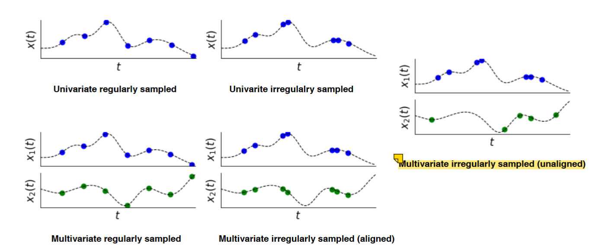
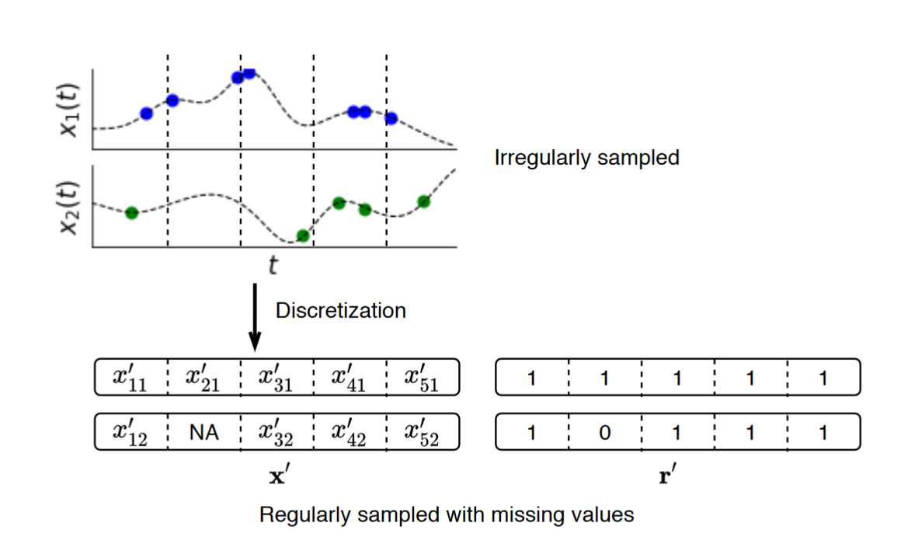
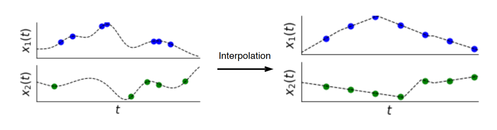
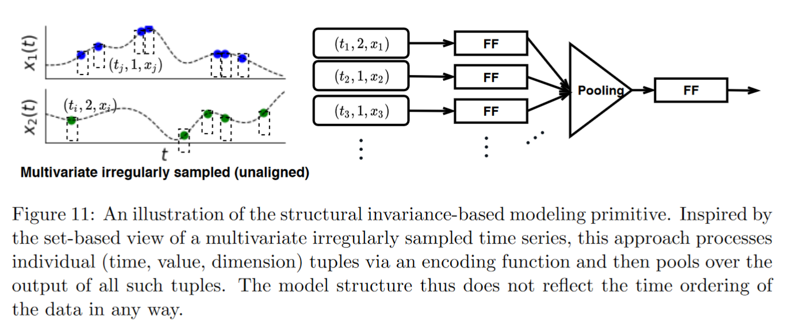

> [!info]
> **TLDR**:: To address the challenges of learning from irregularly sampled time series data, this survey categorizes recent methods by their modeling primitives, including temporal discretization, interpolation, recurrence, attention, and structural invariance.

> [!cite]
> **Bibliography**:: Shukla, S. N., & Marlin, B. M. (2021). _A Survey on Principles, Models and Methods for Learning from Irregularly Sampled Time Series_ (arXiv:2012.00168). arXiv. [https://doi.org/10.48550/arXiv.2012.00168](https://doi.org/10.48550/arXiv.2012.00168)

> [!info]
> **Contribution**:: 不规则综述

## Notes
>
>Comment: Presented at NeurIPS 2020 Workshop: ML Retrospectives, Surveys & Meta-Analyses (ML-RSA).

## 1. Introduction

不规则数据面临的挑战是：

- **Irregular sampling**

    时间间隔并不是不变的，有大有小
- **Variable number of observations**

    不同维度的数据点的个数可能不一样
- **Lack of alignment**

    不同维度的数据可能发生在不同的时间步

## 2. Data Representations

关于如何表示多变量的不规则的时序数据，可以分成三种不同的表示：

- **Series-Based Representation**

    当作是多个单变量的时序数据的集合

    - pros

        不存在需要表示缺失数据的情况
    - cons

        当所有维度在所有时间步上都有观测值的时候，这种表示就显得有些浪费（相比 vector-based）
- **Vector-Based Representation**

    当作多维向量的时序数据

- **Set-based Representation**

    当作元组的集合，每个元组形式为 $(t, d, x)$

    - $t$: 时间点
    - $d$: 维度
    - $x$: 观测值

## 3. Inference Tasks

有监督数据的话，就预测监督的数据，否则就是传统的那几种推断任务

## 4. Modeling Primitives

来看看有什么基本的应对策略

### 4.1 Discretization

离散化

实际上可以理解为重新划分时间间隔，然后重新采样

这样可以将不规则的数据转换成规则但是带缺失值的数据

- pros

    简单
- cons

    质量不及其它

### 4.2 Interpolation

插值，比如线性插值

简单假设缺失值位于相邻数据点的连线上

- pros

    适合所有任务，质量高且比较快

### 4.3 Recurrence

指的是用 RNN 这样的网络，带循环的，一个个吃时间步

- pros

    可以生成高质量

- cons

    速度慢

### 4.4 Attention

> Attention models learn which regions of an input time series to attend to when computing outputs at different points in time by leveraging positional or time encodings.

注意力机制不熟悉

相比于 RNN 来说，能并行可以大幅度提高效率

- pros

    时间短
- cons

    质量不及 RNN 或 interpolation

### 4.5 Structural Invariance

最诡异的莫过于这种，它是基于 set-based 的时序数据的，在处理数据的时候完全可以忽略数据的时间顺序

- pros

    时间短

- cons

    质量不及 RNN 或 interpolation

## 11. Directions for future work

- 大部分研究都集中在有监督任务、填补、平滑，没什么做预测的
- 现有方法的性能衡量存在问题：

    - 一般都没有对于 uncertainty 的衡量
    - 基本都不会生成输出的概率分布（除了基于高斯过程的方法）

## Annotations
%% begin annotations %%

### Imported: 2023-11-28 4:45 pm

> [!quote|#ffd400] <mark style="background-color: #ffd400">Highlight</mark>
> the presence of non-uniform intervals between observations
>
> [Page 1](zotero://open-pdf/library/items/BTGKWJML?page=1) 

> [!quote|#ffd400] <mark style="background-color: #ffd400">Highlight</mark>
> what data representations
>
> [Page 1](zotero://open-pdf/library/items/BTGKWJML?page=1) 

> [!quote|#ffd400] <mark style="background-color: #ffd400">Highlight</mark>
> what modeling primitives
>
> [Page 1](zotero://open-pdf/library/items/BTGKWJML?page=1) 

> [!quote|#ffd400] <mark style="background-color: #ffd400">Highlight</mark>
> temporal discretization, interpolation, recurrence, attention and structural invariance.
>
> [Page 1](zotero://open-pdf/library/items/BTGKWJML?page=1) 

> [!quote|#ffd400] <mark style="background-color: #ffd400">Highlight</mark>
> Multivariate irregularly sampled (unaligned)
>
>> 要不要这么狗
>
> [Page 2](zotero://open-pdf/library/items/BTGKWJML?page=2) 

> [!quote|#ffd400] <mark style="background-color: #ffd400">Highlight</mark>
> Variable number of observations - the total number of observations across dimensions can be different for different data cases.
>
> [Page 2](zotero://open-pdf/library/items/BTGKWJML?page=2) 

> [!quote|#ffd400] <mark style="background-color: #ffd400">Highlight</mark>
> ) Lack of alignment
>
> [Page 3](zotero://open-pdf/library/items/BTGKWJML?page=3) 

> [!quote|#ffd400] <mark style="background-color: #ffd400">Highlight</mark>
> series-based, vector-based, and set-based representations.
>
> [Page 3](zotero://open-pdf/library/items/BTGKWJML?page=3) 

> [!quote|#ffd400] <mark style="background-color: #ffd400">Highlight</mark>
> a collection of univariate time series
>
> [Page 3](zotero://open-pdf/library/items/BTGKWJML?page=3) 

> [!quote|#ffd400] <mark style="background-color: #ffd400">Highlight</mark>
> time series of vector-valued observations
>
> [Page 3](zotero://open-pdf/library/items/BTGKWJML?page=3) 

> [!quote|#ffd400] <mark style="background-color: #ffd400">Highlight</mark>
> views a multivariate irregularly sampled time series as a set of tuples of the form (t, d, x) where t is a time point, d is a dimension, and x is the observed value of dimension d at time t.
>
> [Page 3](zotero://open-pdf/library/items/BTGKWJML?page=3) 

> [!quote|#ffd400] <mark style="background-color: #ffd400">Highlight</mark>
> We define modeling primitives to be the basic building blocks or modules leveraged in larger and more complex models
>
> [Page 3](zotero://open-pdf/library/items/BTGKWJML?page=3) 

> [!quote|#ffd400] Image
> ![[attachments/shuklaSurveyPrinciplesModels2021/image-4-x65-y336.png]]
>
> [Page 4](zotero://open-pdf/library/items/BTGKWJML?page=4) 

> [!quote|#ffd400] <mark style="background-color: #ffd400">Highlight</mark>
> each element of an output sequence learns which elements of an input sequence to attend to without relying on recurrent network structures.
>
> [Page 16](zotero://open-pdf/library/items/BTGKWJML?page=16) 

> [!quote|#ffd400] <mark style="background-color: #ffd400">Highlight</mark>
> Q, K, V denote the query, key, value representation
>
> [Page 16](zotero://open-pdf/library/items/BTGKWJML?page=16) 

> [!quote|#ffd400] <mark style="background-color: #ffd400">Highlight</mark>
> applying an initial encoder fθ to individual time-dimension-value tuples.
>
> [Page 17](zotero://open-pdf/library/items/BTGKWJML?page=17) 

> [!quote|#ffd400] <mark style="background-color: #ffd400">Highlight</mark>
> Due to the deterministic nature of the ODE model, it suffices to identify the distribution over the latent space at any single time t
>
> [Page 25](zotero://open-pdf/library/items/BTGKWJML?page=25) 

> [!quote|#ffd400] <mark style="background-color: #ffd400">Highlight</mark>
> does not directly accommodate irregularly sampled time series of incompletely observed vectors
>
> [Page 26](zotero://open-pdf/library/items/BTGKWJML?page=26) 

> [!quote|#ffd400] <mark style="background-color: #ffd400">Highlight</mark>
> imputed values for missing dimensions have maximum uncertainty immediately before the next observation.
>
> [Page 26](zotero://open-pdf/library/items/BTGKWJML?page=26) 

> [!quote|#ffd400] <mark style="background-color: #ffd400">Highlight</mark>
> once θ has been learned, then the solution of Equation 16 is determined by the initial condition at z0, and there is no direct mechanism for incorporating data or hidden state at a later time
>
> [Page 26](zotero://open-pdf/library/items/BTGKWJML?page=26) 

> [!quote|#ffd400] <mark style="background-color: #ffd400">Highlight</mark>
> have the capability to deal with incomplete observations by independently interpolating each channels.
>
> [Page 27](zotero://open-pdf/library/items/BTGKWJML?page=27) 

> [!quote|#ffd400] <mark style="background-color: #ffd400">Highlight</mark>
> ODE models can be quite a bit slower during training and deployment due to the need to make repeated calls to an ODE solver.
>
> [Page 27](zotero://open-pdf/library/items/BTGKWJML?page=27) 

> [!quote|#ffd400] <mark style="background-color: #ffd400">Highlight</mark>
> discretization-based methods for irregular sampling data are typically outperformed by models with the ability to directly use an irregularly sampled time series as input.
>
> [Page 28](zotero://open-pdf/library/items/BTGKWJML?page=28) 

> [!quote|#ffd400] <mark style="background-color: #ffd400">Highlight</mark>
> simple, easy to implement, and modular baseline
>
> [Page 31](zotero://open-pdf/library/items/BTGKWJML?page=31) 

> [!quote|#ffd400] <mark style="background-color: #ffd400">Highlight</mark>
> basic discrete RNNs are more well suited for detection and prediction tasks than interpolation and smoothing problems
>
> [Page 31](zotero://open-pdf/library/items/BTGKWJML?page=31) 

> [!quote|#ffd400] <mark style="background-color: #ffd400">Highlight</mark>
> Using time stamps or time deltas as additional inputs appears to be helpful in overcoming the gap between representing a sequence and representing an irregularly sampled time series.
>
> [Page 31](zotero://open-pdf/library/items/BTGKWJML?page=31) 

> [!quote|#ffd400] <mark style="background-color: #ffd400">Highlight</mark>
> ODE-based recurrent approaches provide a more elegant solution to dealing with irregular sampling than discrete RNNs and can be applied to all tasks described in Section 3.
>
> [Page 31](zotero://open-pdf/library/items/BTGKWJML?page=31) 

> [!quote|#ffd400] <mark style="background-color: #ffd400">Highlight</mark>
> still have limitations related to their nature as intrinsic filtering methods as well as their inability to accommodate incomplete vector-valued observations
>
> [Page 31](zotero://open-pdf/library/items/BTGKWJML?page=31) 

> [!quote|#ffd400] <mark style="background-color: #ffd400">Highlight</mark>
> These models have also been shown to be substantially faster to train than Gaussian process regression and ODE-based models
>
> [Page 31](zotero://open-pdf/library/items/BTGKWJML?page=31) 

> [!quote|#ffd400] <mark style="background-color: #ffd400">Highlight</mark>
> However, to date these models have been able to meet but not exceed the performance of ODE and interpolation-based methods.
>
> [Page 31](zotero://open-pdf/library/items/BTGKWJML?page=31) 

> [!quote|#ffd400] <mark style="background-color: #ffd400">Highlight</mark>
> focused most heavily on supervised problems, followed by interpolation and smoothing.
>
> [Page 32](zotero://open-pdf/library/items/BTGKWJML?page=32) 

> [!quote|#ffd400] <mark style="background-color: #ffd400">Highlight</mark>
> The development of methods for learning to forecast accurately from irregularly sampled inputs thus appears to be a significantly more open problem than the development of methods for the other tasks described
>
> [Page 32](zotero://open-pdf/library/items/BTGKWJML?page=32) 

> [!quote|#ffd400] <mark style="background-color: #ffd400">Highlight</mark>
> uncertainty
>
> [Page 32](zotero://open-pdf/library/items/BTGKWJML?page=32) 

> [!quote|#ffd400] <mark style="background-color: #ffd400">Highlight</mark>
> do not produce probability distributions as outputs at all, apart from models based on Gaussian processes.
>
> [Page 32](zotero://open-pdf/library/items/BTGKWJML?page=32) 

%% end annotations %%

> [!quote|#ffd400] Image
>
> [Page 4](zotero://open-pdf/library/items/BTGKWJML?page=4)

%% Import Date: 2026-05-12T00:53:28.000+00:00 %%
